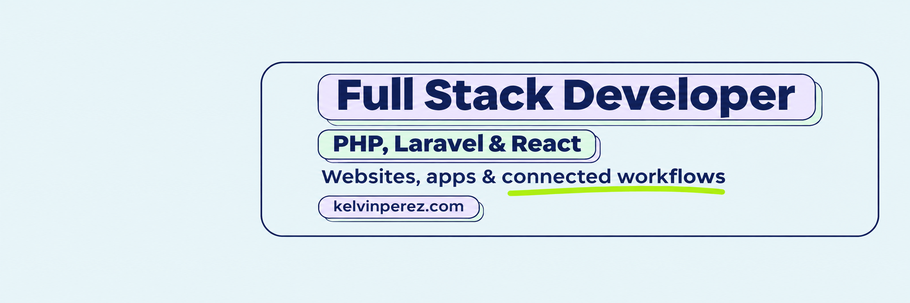

# Kelvin Perez

**Full Stack Developer | PHP, Laravel & React | Marketing Technology & AI Automation**

I build websites, applications, ecommerce experiences, and connected workflows with equal care for the interface and the engineering behind it. My 10 years of web development experience span agency delivery, WordPress, ecommerce, and full stack applications.

## Form and function, together

Good design is part of what makes software useful. I care about clear hierarchy, responsive layouts, helpful feedback, and interactions that feel considered, alongside reliable, maintainable systems. Design is part of what keeps me motivated to keep refining a product.

My design toolkit includes Figma, Sketch, and Photoshop, supported by study of color theory, typography, and UI/UX fundamentals. I bring that grounding into the interfaces I build and the designs I implement.

## Applications and integrations

Through Light Code Labs, I built workflows connecting browser-based lead capture, enrichment, CRM operations, website previews, knowledge retrieval, and automated follow up. The platform brings together Laravel, React, TypeScript, PostgreSQL, APIs, webhooks, n8n, queues, scheduled jobs, and background processing.

## Websites and ecommerce

My professional work includes custom WordPress themes and plugins, reusable content models, responsive interfaces, landing pages, technical SEO, and Shopify and WooCommerce experiences. The SunnySide 24/7 AC platform supports 487+ localized service pages through reusable templates and structured content.

## Marketing Technology & AI Automation

I connect lead capture, CRM workflows, APIs, webhooks, and business processes through integrations and automation. My work includes retrieval-based chatbot functionality and structured business knowledge sources.

My email portfolio includes responsive promotional, newsletter, and transactional examples with inspectable source. I'm continuing to build direct experience with HubSpot, Klaviyo, and lifecycle implementation.

## Technical foundation

PHP, Laravel, React, TypeScript, JavaScript, HTML, CSS, WordPress, MySQL, PostgreSQL, APIs, webhooks, n8n, Docker, Git, and automated testing with Pest, Jest, Mocha, and Chai.

## Opportunities

Based in Iowa, United States, I'm open to fully remote roles across full stack development, PHP/Laravel, WordPress and marketing web development, frontend implementation, integrations, email development, and marketing technology.

I care about clear requirements, reusable systems, responsive execution, careful testing, and software that is straightforward to explain and maintain.

## Explore my work

[Portfolio](https://kelvinperez.com) · [LinkedIn](https://www.linkedin.com/in/thekelvinperez/) · [YouTube](https://www.youtube.com/@thekelvinperez) · [X](https://x.com/thekelvinperez)

Email: [thekelvinperez@gmail.com](mailto:thekelvinperez@gmail.com)
